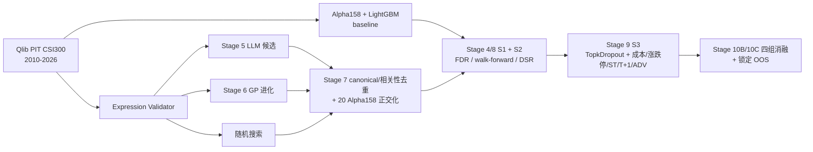

# LLM-GP Factor Lab（LLM + GP 因子挖掘实验室）

一个 LLM + GP 因子挖掘的研究原型，带多阶段验证流程。
项目分阶段推进：先建立可复现的 Qlib 基线，再做因子生成，最后进行严格筛选。

> 所有项目报告统一放在 `项目报告/`（已加入 `.gitignore`，只在本地保留）；
> GitHub 仓库只上传代码、配置、脚本和测试，不含 `项目报告/`、`data/`、
> `artifacts/`、`.env`；README 中指向这些本地目录的链接在 GitHub 上不可用。
> `reports/` 只保留运行日志。

## 方法总览



## 进展状态

- **阶段 0**：环境、Qlib 数据、数据覆盖报告 —— 已完成。
- **阶段 1**：`Alpha158 + LightGBM + TopkDropout` 基线 —— 已完成；历史产物在
  `artifacts/baseline/`。
- **阶段 2**：数据质量检查、空洞修补、外部对账、数据快照 —— 已完成；
  旧数据报告见 [`项目报告/stage2_completion_cn_data_v3.md`](项目报告/stage2_completion_cn_data_v3.md)。
- **阶段 2.7**：数据源切换（`investment_data`）+ PIT CSI300 + PIT baseline ——
  已完成；见 [`项目报告/stage2_completion.md`](项目报告/stage2_completion.md)。
- **阶段 3**：表达式 Validator + Evaluator、PIT 因子评估、批量榜单 —— 已完成；
  见 [`项目报告/Stage3_表达式校验与评估_项目报告.md`](项目报告/Stage3_表达式校验与评估_项目报告.md)。
- **阶段 4**：S1 单因子标准化、评分卡、FDR、因子存储 —— 已完成；
  见 [`项目报告/Stage4_S1单因子标准化_项目报告.md`](项目报告/Stage4_S1单因子标准化_项目报告.md)。
- **阶段 5**：LLM 候选生成、Validator、S1 快筛、trial ledger —— 已完成；
  见 [`项目报告/Stage5_LLM因子生成_项目报告.md`](项目报告/Stage5_LLM因子生成_项目报告.md)。
- **阶段 6**：GP 进化（类型化表达式树、LLM 种子、2000 次评估）—— 已完成；
  见 [`项目报告/Stage6_GP进化_项目报告.md`](项目报告/Stage6_GP进化_项目报告.md)。
- **阶段 7**：canonical 去重、相关性聚类、Alpha158 正交化 —— 已完成；
  见 [`项目报告/Stage7_去重与共线性_项目报告.md`](项目报告/Stage7_去重与共线性_项目报告.md)。
- **阶段 8**：S2 walk-forward、子样本、安慰剂、FDR/DSR —— 已完成；
  见 [`项目报告/Stage8_S2稳健性_项目报告.md`](项目报告/Stage8_S2稳健性_项目报告.md)。
- **阶段 9**：S3 组合、成本/约束、容量与归因 —— 已完成（**验证未通过**）；
  见 [`项目报告/Stage9_S3组合_项目报告.md`](项目报告/Stage9_S3组合_项目报告.md)。
- **阶段 10**：四组消融 + 锁定 OOS（2020-09-24 至 2023-06-12）—— 已完成；
  结论是 **LLM+GP 没有可证明的 OOS 增量**；见
  [`项目报告/Stage10_消融与OOS_项目报告.md`](项目报告/Stage10_消融与OOS_项目报告.md)。
- **阶段 10B**：消融与 OOS 修订（30 条/组、A/B 3 seeds、S1 校准/选择分离、
  相关性去重、阈值敏感性、Clopper-Pearson CI）—— 已完成；
  旧版 A/B“0/5”被证实是样本假象，但 **LLM+GP 仍无可证明的 OOS 增量**；
  见 [`项目报告/Stage10B_消融与OOS_修订_项目报告.md`](项目报告/Stage10B_消融与OOS_修订_项目报告.md)。
- **阶段 10C**：新 OOS（2023-06-13 至 2026-10-23，该区间第一次使用），
  约束改用 zzshare 精确涨跌停/ST/停牌数据 —— 已完成；四组净超额
  全部为负（-4.4 ~ -9.1pp），**LLM+GP 仍没有可证明的 OOS 增量**；见
  [`项目报告/Stage10C_新OOS_2023-2026_项目报告.md`](项目报告/Stage10C_新OOS_2023-2026_项目报告.md)。
- **阶段 11**：打包、5 分钟 demo、一页摘要、面试 Q&A、代码清理 —— 已完成；
  见 [`项目报告/Stage11_打包_项目报告.md`](项目报告/Stage11_打包_项目报告.md)。

## 结果摘要（截至 Stage 10C）

| 环节 | 结果 |
|---|---|
| Alpha158 + LightGBM baseline（2019–2020-09，描述性） | RankIC **0.0401**，ICIR 0.325；年化 46.1%，含成本净超额 **+14.4%**，IR 1.70 |
| Stage 5 LLM | 236 条合并候选，**230 valid（97.5%）** |
| Stage 6 GP | 2000 次评估、18 代；best fitness 0.163，RankIC 0.034 |
| Stage 7 去重 | 55 → 11 个相关性代表；13 个语义簇 |
| Stage 8 S2 | 14 → **7 pass** |
| Stage 9 S3 | 81 个参数组合 **0 个正 IR**；test 净超额 **-13.8%**，IR -1.76 |
| Stage 10C OOS（2023–2026） | 净超额 A **-5.22%**、B **-5.16%**、C **-9.14%**、D **-4.43%**；D−B +0.72pp，95% CI [-9.40, +13.04] |

**核心结论**：在当前预算和协议下，**LLM+GP 没有可证明的 OOS 增量**；
S1 通过率不等于 OOS 净收益；18–20x 换手和 4.6–5.0pp 成本拖累使四组 OOS
全部为负。负结果和数据质量发现（Dolt 300/688 的 10% 限价 bug）都如实保留。

## Demo 与材料

- 5 分钟 demo：[`demo/stage11_demo.ipynb`](demo/stage11_demo.ipynb)
  （读取 `artifacts/`，不重跑回测）
- 一页摘要：[`项目报告/Stage11_一页摘要.md`](项目报告/Stage11_一页摘要.md)
- 面试 Q&A：[`项目报告/Stage11_面试QA.md`](项目报告/Stage11_面试QA.md)
- 报告索引：[`项目报告/README.md`](项目报告/README.md)

## 数据源与环境

- Windows 11 原生环境，Python 3.12
- Qlib 0.9.7，LightGBM 4.7
- **主数据源**：`chenditc/investment_data`（Qlib bin，Apache-2.0 仓库）
  - 解压目录：`D:/qlib_data/cn_data_investment_data/extracted/qlib_bin`
  - Release：`2026-10-25`（target trade date 2026-10-23）
  - 压缩包 SHA256：`0a2974da97b4737e503ecddeea8bb3b2179e0e16ea0fb19fa373ff14155bf315`
  - 多源合并（Wind/Caihui/Tushare/AkShare/Baostock/Yahoo），不是交易所官方数据
  - 日历：2000-01-04 至 2026-10-23，6,494 天；Stage 1–9 使用
    2010-01-01 至 2020-09-23，Stage 10C 用到 2026-10-23
  - 字段：`open/high/low/close/volume/factor/adjclose/amount/vwap/change`
  - `volume` 是调整后的**手**（1 手 = 100 股）：
    `raw_volume_shares = volume * factor * 100`，`turnover_cny = volume * close * 100`
- **旧 fallback**：`D:/qlib_data/cn_data_v3`（Yahoo 社区数据，已补洞；快照
  `qlib-2f1550fea963`）
- 外部数据：
  - Tushare `daily`：300 只标的的行情缓存与对账
  - AkShare Sina：原始/前复权价，用于对账
  - DoltHub `final_a_stock_limit`：PIT 涨跌停价（已导出，2,609 天 / 782,425 行）
  - AkShare Sina 行业：49 个当前行业分类，仅用于 Stage 9 Brinson；
    不是 PIT 行业历史（`data/processed/sector_map.parquet`）
- 数据快照：`qlib-pit-7c6be6609542`（[`项目报告/qlib_snapshot.json`](项目报告/qlib_snapshot.json)）

## 股票池（PIT CSI300）

主口径使用 `instruments/csi300.txt` 的 **PIT 区间**，不是 frozen 成分：

- 2010–2020-09-23：661 只历史成分，782,700 个成员-日；
- 每天恰好 **300** 只（min = max = median = 300）；
- baseline 使用 `PITAlpha158`：先加载 `csi300` 的 union，再按日度成员表过滤。

旧的 `csi300_frozen`（2020 成分回溯）只保留为历史 fallback，不再作为主结果。
详见 [`项目报告/stage2_completion.md`](项目报告/stage2_completion.md) 和
[`项目报告/investment_data_validation.md`](项目报告/investment_data_validation.md)。

## 数据质量结论

完整新数据验证见 [`项目报告/investment_data_validation.md`](项目报告/investment_data_validation.md)。

- **日历**：2010–2020-09-23 的 2,609 个官方交易日 **0 缺失**；旧数据缺 47 天的问题已消失。
- **2020-09-28**：新数据没有复权因子重置；SH600000 原始价 9.47→9.46 连续，
  SH000300 原始点位 4570→4582 连续。
- **数据空洞**：相对 AkShare 的 `data_hole` = **0**；旧数据补洞后仍有 7 个标的-日。
- **NaN**：close NaN 21,551（3.30%），主要是停牌/无交易。
- **PIT**：PIT CSI300 每天恰好 300 只，成分前视已修复。
- **字段**：新增 `vwap`、`amount`、`change`、`adjclose`；Alpha158 的 VWAP 特征不再缺失。
- **价格异常**：raw 硬跳变 120 个，全部是公司行为（adjusted return 都在 ±21% 内）；
  拆股/公司行为日 283 个；2020-09-28 因子重置 0。
- **对账**：新数据 vs AkShare 原始收益 **99.999%**、复权收益 **99.38%**；
  成交额修正 volume 单位后 **100%**；旧/新 raw return 匹配 99.79%。
- **ST/涨跌停**：新 Qlib 归档不含 ST/limit；已从 DoltHub `final_a_stock_limit`
  导出 2,609 天、782,425 行，并生成 PIT 约束面板：停牌 24,564 个标的-日、
  ST 640 个标的-日、涨/跌停触及 9,594 / 7,288。20% 板块的 ST 仍标 unknown。

旧数据的 47 个缺日、2020-09-28 复权重置、2,561 个空洞、7 个残余空洞等诊断，
保留在 [`项目报告/data_quality_pre_patch.md`](项目报告/data_quality_pre_patch.md) 和
[`项目报告/stage2_completion_cn_data_v3.md`](项目报告/stage2_completion_cn_data_v3.md)。

## 快速开始

### 最短路径（新机器 5 条命令，跑通 PIT baseline）

```bash
# 1) 环境（Python 3.12）
py -3.12 -m venv .venv && .venv/Scripts/python.exe -m pip install -r requirements.txt

# 2) 下载 Qlib bin（默认解压到 D:/qlib_data/cn_data_investment_data/extracted/qlib_bin）
.venv/Scripts/python.exe -I scripts/download_investment_data_parallel.py --workers 8 --chunk-mb 32 --extract

# 3) 构建 PIT CSI300 成员表
.venv/Scripts/python.exe -I scripts/build_pit_universe.py

# 4) PIT baseline（quick 模式）
.venv/Scripts/python.exe scripts/run_baseline.py --quick --output-dir artifacts/baseline_quick_pit

# 5) 测试
.venv/Scripts/python.exe -m pytest -q
```

> 默认 provider 路径是 `D:/qlib_data/cn_data_investment_data/extracted/qlib_bin`；
> 如果数据放在别处，修改 `configs/baseline.yaml` 的 `provider_uri`。
> 第 2 步下载的是多源合并数据，不是交易所官方数据；详见“数据源与环境”。

### 完整流水线（数据质量 → Stage 10C）

```bash
cd D:/quant/llm-gp-factor-lab

# 1) 环境（首次执行）
# py -3.12 -m venv .venv
# .venv/Scripts/python.exe -m pip install -r requirements.txt

# 2) 下载并校验 investment_data（GitHub API asset 端点）
.venv/Scripts/python.exe -I scripts/download_investment_data_parallel.py \
  --workers 8 --chunk-mb 32 --extract

# 3) 构建 PIT CSI300 成员表
.venv/Scripts/python.exe -I scripts/build_pit_universe.py

# 4) 数据质量：新数据探针 + 新旧对比
.venv/Scripts/python.exe -I scripts/probe_investment_data.py \
  --provider-uri D:/qlib_data/cn_data_investment_data/extracted/qlib_bin
.venv/Scripts/python.exe -I scripts/compare_providers.py \
  --new D:/qlib_data/cn_data_investment_data/extracted/qlib_bin \
  --old D:/qlib_data/cn_data_v3

# 5) 完整质量检查（300 只旧 frozen 子集，结果写到临时目录）
.venv/Scripts/python.exe -I scripts/data_quality.py \
  --provider-uri D:/qlib_data/cn_data_investment_data/extracted/qlib_bin \
  --universe data/universes/csi300_frozen.txt \
  --reports-dir 项目报告/investment_data_check \
  --processed-dir data/processed/investment_data_check \
  --start 2010-01-01 --end 2020-09-23 --sample-size 100

# 6) 生成 PIT 快照
.venv/Scripts/python.exe -I scripts/build_pit_snapshot.py

# 7) PIT baseline
.venv/Scripts/python.exe scripts/run_baseline.py --output-dir artifacts/baseline_pit

# 8) 对比与校验
.venv/Scripts/python.exe scripts/compare_baseline_pit.py
.venv/Scripts/python.exe scripts/validate_baseline.py --artifacts artifacts/baseline_pit

# 9) Dolt 涨跌停导出 + PIT 约束面板（S3 前）
.venv/Scripts/python.exe -I scripts/fetch_dolt_limits.py --workers 4 --chunk-days 3
.venv/Scripts/python.exe -I scripts/build_pit_constraints.py

# 10) Stage 3：表达式校验 + 单因子评估（PIT）
.venv/Scripts/python.exe scripts/validate_expression.py --alpha158
.venv/Scripts/python.exe scripts/evaluate_factor.py \
  --expr 'Mean($close, 5)/$close - 1' --name ma5 \
  --output-dir artifacts/factor_eval/ma5_full
.venv/Scripts/python.exe scripts/evaluate_factor.py --alpha158-sample 3
.venv/Scripts/python.exe -I scripts/verify_factor_eval.py

# 11) Stage 4：S1 单因子标准化与评分卡
.venv/Scripts/python.exe scripts/screen_factors.py --known --alpha158-sample 5

# 12) Stage 5：LLM 候选生成 + S1 快筛
.venv/Scripts/python.exe scripts/generate_factors.py \
  --model deepseek-chat --n 200 --no-screen --seed-alpha158 \
  --run-dir data/mining/run_stage5_200
.venv/Scripts/python.exe scripts/generate_factors.py \
  --screen-only --run-dir data/mining/run_stage5_200

# 13) Stage 6：GP 进化
.venv/Scripts/python.exe scripts/run_gp.py --budget 2000 \
  --output-dir data/mining/gp_run_full_v2

# 14) Stage 7：去重与共线性
.venv/Scripts/python.exe scripts/dedupe_factors.py

# 15) Stage 8：S2 稳健性
.venv/Scripts/python.exe scripts/s2_robustness.py

# 16) Stage 9：S3 组合（先抓静态行业映射，已缓存可跳过）
.venv/Scripts/python.exe -I scripts/fetch_sector_map.py
.venv/Scripts/python.exe scripts/run_portfolio.py
.venv/Scripts/python.exe -I scripts/plot_stage9.py

# 17) Stage 10：消融 + 锁定 OOS（A/B 搜索较慢，可复用已有 ledger）
.venv/Scripts/python.exe -I scripts/build_stage10_universe.py --oos-end 2023-06-12
.venv/Scripts/python.exe -I scripts/build_stage10_constraints.py
.venv/Scripts/python.exe -I scripts/run_random_search.py --budget 500 --seed 123
.venv/Scripts/python.exe -I scripts/run_gp_worker.py --budget 500 --seed 43 \
  --output-dir data/mining/stage10_gp_only
.venv/Scripts/python.exe -I scripts/run_ablation.py
.venv/Scripts/python.exe -I scripts/plot_stage10.py

# 18) Stage 10B：消融修订（A/B 各 3 seeds × 230，耗时较长）
for s in 101 102 103; do
  .venv/Scripts/python.exe -I scripts/run_random_search.py --budget 230 --seed $s \
    --output-dir data/mining/stage10b_random_seed$s
done
for s in 201 202 203; do
  .venv/Scripts/python.exe -I scripts/run_gp_worker.py --budget 230 --seed $s \
    --output-dir data/mining/stage10b_gp_seed$s
done
.venv/Scripts/python.exe -I scripts/run_ablation.py \
  --config configs/stage10b.yaml --output-dir artifacts/stage10b
.venv/Scripts/python.exe -I scripts/plot_stage10b.py
```

旧 fallback（`cn_data_v3`）的补洞/baseline 命令保留在
[`项目报告/stage2_completion_cn_data_v3.md`](项目报告/stage2_completion_cn_data_v3.md)。

## 产物

PIT 主口径：

- `artifacts/baseline_pit/`：PIT baseline 的 metrics、预测、IC、组合报告、图表
- `artifacts/stage9/`：S3 组合的 validation grid、NAV、交易、归因、容量、对账
- `data/processed/pit_csi300_membership.parquet`：PIT 日度成员
- `data/processed/pit_csi300_constraints.parquet`：PIT ST/涨跌停/停牌面板
- `data/processed/sector_map.parquet`：静态 Sina 行业映射（用于 Brinson）
- `项目报告/pit_constraints_summary.json`：PIT 约束摘要
- `data/manifests/qlib_snapshot.json`：快照 `qlib-pit-7c6be6609542`
- `项目报告/investment_data_validation.md`：新数据验证报告
- `项目报告/provider_comparison.json`：新旧数据对比
- `项目报告/investment_data_check/`：新数据质量检查
- `项目报告/baseline_pit_comparison.md` / `.json`：旧 frozen vs 新 PIT
- `项目报告/stage2_completion.md`：Stage 2 完成报告

Stage 3：

- `artifacts/factor_eval/ma5_full/`：MA5 全区间评估（metrics/IC/分层/多空）
- `artifacts/factor_eval/alpha158_sample3/`：3 条 Alpha158 因子的批量榜单
- `data/processed/factor_cache/`：按表达式/config 哈希缓存的因子与标签面板
- `scripts/validate_expression.py`、`scripts/evaluate_factor.py`：Stage 3 CLI
- `scripts/verify_factor_eval.py`：MA5 的独立 pandas 复核
- `项目报告/Stage3_表达式校验与评估_项目报告.md`：Stage 3 报告

Stage 4：

- `artifacts/s1/calibration/`：S1 评分卡与汇总
- `data/factor_store/`：`s1_scorecard.parquet` / `.csv` / `s1.sqlite`，以及逐因子 metrics
- `configs/s1.yaml`：S1 口径、阈值、校准/留出窗口
- `scripts/screen_factors.py`：S1 批量评估与评分卡 CLI
- `项目报告/Stage4_S1单因子标准化_项目报告.md`：Stage 4 报告

Stage 5：

- `src/mining/`：schema、prompt、LLM 客户端、生成循环、ledger、S1 快筛
- `scripts/generate_factors.py`：Stage 5 CLI
- `configs/llm.yaml`：模型、生成参数、预算、快筛窗口
- `data/mining/run_stage5_200/`：200 条主批量、batches/trials ledger、S1 scorecard
- `data/mining/run_stage5_topup/`：30 条 top-up 与 S1 scorecard
- `data/mining/stage5_combined_scorecard.csv` / `.parquet`：229 条合并评分卡
- `data/mining/stage5_candidates_combined.parquet`：230 条合并候选
- `项目报告/Stage5_LLM因子生成_项目报告.md`：Stage 5 报告

Stage 6：

- `src/mining/gp.py`：类型化表达式树、变异/交叉/种子解析
- `src/mining/gp_eval.py`：100 股 / 2 年快速适应度
- `src/mining/gp_runner.py`：种群、精英、注入、hall of fame
- `configs/gp.yaml`：种群、代数、预算、适应度权重
- `scripts/run_gp.py`：Stage 6 CLI
- `data/mining/gp_run_full_v2/`：2000 次评估的 summary、hall、generations、trials
- `项目报告/Stage6_GP进化_项目报告.md`：Stage 6 报告

Stage 7：

- `src/evaluation/dedupe.py`：候选加载、canonical 去重、相关性聚类
- `src/evaluation/orthogonalize.py`：Alpha158 ridge 正交化与增量 IC
- `configs/stage7.yaml`：相关/语义阈值、正交化参数
- `scripts/dedupe_factors.py`：Stage 7 CLI
- `artifacts/stage7/`：相关矩阵、cluster、代表、增量 IC、summary
- `项目报告/assets/stage7_*.png`：相关热力图、聚类树
- `项目报告/Stage7_去重与共线性_项目报告.md`：Stage 7 报告

Stage 8：

- `src/evaluation/robustness.py`：walk-forward、子样本、placebo、FDR/DSR
- `configs/gates.yaml`：S2 门槛与评估窗口
- `scripts/s2_robustness.py`：Stage 8 CLI
- `artifacts/stage8/`：S2 scorecard、详情、summary
- `项目报告/Stage8_S2稳健性_项目报告.md`：Stage 8 报告

Stage 9：

- `src/portfolio/`：因子合成、TopkDropout 模拟器、成本、指标、归因、对账
- `configs/portfolio.yaml`：数据划分、成本/约束、参数网格、情景、容量、归因
- `scripts/run_portfolio.py`：Stage 9 CLI
- `scripts/plot_stage9.py`：报告图表
- `scripts/fetch_sector_map.py`：Sina 静态行业映射（当前分类，不是 PIT）
- `artifacts/stage9/`：validation grid、NAV、交易、容量、归因、summary
- `项目报告/assets/stage9_*.png`：NAV、回撤、参数热力图、容量、情景
- `项目报告/Stage9_S3组合_项目报告.md`：Stage 9 报告

Stage 10：

- `configs/stage10.yaml`：组、500/230/2000 预算、S1、组合、OOS 日期
- `scripts/build_stage10_universe.py`：2010–2026 PIT 成员扩展
- `scripts/build_stage10_constraints.py`：2020–2023 OOS 约束
- `scripts/run_random_search.py`、`scripts/run_gp_worker.py`：A/B worker 搜索
- `scripts/run_ablation.py`：消融、S1、增量 IC、OOS、协议锁
- `scripts/plot_stage10.py`：报告图表
- `artifacts/stage10/`：ablation、S1、增量 IC、OOS、protocol/lock
- `data/mining/stage10_random/`、`data/mining/stage10_gp_only/`
- `项目报告/assets/stage10_*.png`
- `项目报告/Stage10_消融与OOS_项目报告.md`：Stage 10 报告

Stage 10B：

- `configs/stage10b.yaml`：30 条/组、3 seeds、coverage/相关性过滤、S1 敏感性
- `scripts/run_ablation.py --config configs/stage10b.yaml`：复用同一消融 pipeline
- `scripts/plot_stage10b.py`：Stage 10B 图表
- `artifacts/stage10b/`：ablation、S1、增量 IC、OOS、敏感性、protocol/lock
- `data/mining/stage10b_random_seed10{1,2,3}/`、`stage10b_gp_seed20{1,2,3}/`
- `项目报告/assets/stage10b_*.png`
- `项目报告/Stage10B_消融与OOS_修订_项目报告.md`：Stage 10B 报告

Stage 10C：

- `configs/stage10c.yaml`：新 OOS 2023-06-13 至 2026-10-23、约束路径、门槛
- `scripts/fetch_zzshare_daily.py`：zzshare 日线抓取（10 req/min、缓存、manifest）
- `scripts/build_stage10c_constraints.py`：新 OOS 约束面板
- `scripts/validate_stage10c_constraints.py`：与 Dolt 重叠区间对账
- `scripts/compare_stage10c_s1.py`：10B/10C S1 状态对比
- `scripts/bootstrap_stage10c.py`：日收益 block bootstrap
- `scripts/report_stage10c.py`：从 artifacts 生成 Markdown 结果表
- `scripts/plot_stage10c.py`：Stage 10C 图表
- `artifacts/stage10c/`：summary、S1、增量 IC、OOS、bootstrap、protocol/lock
- `data/raw/zzshare/`：原始响应与 manifest
- `data/processed/stage10c_pit_csi300_constraints.parquet`
- `项目报告/assets/stage10c_*.png`
- `项目报告/Stage10C_新OOS_2023-2026_项目报告.md`：Stage 10C 报告

旧数据/历史：

- `artifacts/baseline/`、`baseline_masked/`、`baseline_patched/`
- `项目报告/data_quality.md`、`data_quality_pre_patch.md`
- `项目报告/qlib_snapshot_cn_data_v3.json`
- `data/raw/{baostock,akshare,tushare,dolt}/`、`data/raw/manifests/`

## 基线设计

| 项目 | 取值 |
|---|---|
| 数据源 | `investment_data` Qlib bin |
| 股票池 | PIT CSI300（每天 300 只） |
| 特征 | Qlib Alpha158 |
| 模型 | LightGBM 回归 |
| 标签 | 下一个交易日收益 |
| 数据划分 | 训练 2010–2016，验证 2017–2018，测试 2019–2020-09-23 |
| 组合 | TopkDropout，topk=50，n_drop=5 |
| 信号时点 | 信号平移 1 个交易日，`deal_price=close` |
| 成本 | 买入 5bp，卖出 15bp，最低 5 元，100 股一手 |
| 基准 | SH000300 |

### PIT baseline 结果（单次测试切分，并非经过验证的策略）

| 指标 | 数值 |
|---|---:|
| 测试 IC 天数 | 422 |
| RankIC 均值 | 0.0401 |
| ICIR（日频） | 0.325 |
| Newey-West t 值 | 5.97 |
| 多空年化收益（毛收益） | 44.5% |
| Top-20% 换手率（日频） | 55.3% |
| 含成本超额收益（年化） | 14.4% |
| 含成本超额信息比率 | 1.70 |
| 组合最大回撤 | -17.9% |

> 旧 frozen 数据为 23.5%/IR 2.40；新 PIT 降到 14.4%/1.70。这不是退步：
> 旧 frozen 用 2020 年成分回看 2010 年，会高估收益。新 PIT 更可信。
> 完整对比见 [`项目报告/baseline_pit_comparison.md`](项目报告/baseline_pit_comparison.md)。
> 这是基线参考，不是投资结论；测试窗口是单一有利行情，尚无 walk-forward/OOS。

## Stage 3 表达式校验与评估

- **Validator**：用 `ast` 解析表达式，不允许 Python `eval` 直接接触原始字符串；
  字段/算子白名单；拒绝 `Ref($field, -k)`、负窗口、`Feature(...)`、
  `ChangeInstrument(...)`、过复杂表达式；输出 canonical 表达式和 SHA256。
- **Evaluator**：固定快照 `qlib-pit-7c6be6609542` + PIT CSI300；
  标签与 baseline 一致（`Ref($close,-2)/Ref($close,-1)-1`）；计算
  RankIC/ICIR/Newey-West t、分层收益、IC 衰减、换手和 rank 自相关；
  因子/标签面板按 config 哈希缓存。
- **自检**：Alpha158 的 158 条表达式全部通过 Validator，44 个算子通过 Qlib
  解析检查；MA5 全区间 RankIC 0.0414、ICIR 0.224、NW t 11.7、
  覆盖率 96.9%；独立 pandas 复核的 2609 个共同交易日最大 RankIC 差
  `0.00027`。
- 3 条 Alpha158 样本（MIN60/CNTN10/KMID）的 RankIC 分别为
  0.0224/0.0202/-0.0299，仅用于验证评估链路，不是策略结论。

> Stage 3 只做“能安全算、能统一比较”，不做因子生成和组合回测；
> 全区间指标包含训练/验证段，不能当作样本外表现。

## Stage 4 S1 单因子标准化

- **预处理**：按日截面 1%/99% winsorize，再做截面 z-score；
  行业/市值中性化留了接口，但当前快照没有行业和市值字段，默认不启用。
- **评估窗口**：2010–2018 用于评分卡和阈值校准；2019–2020 作为
  holdout 单独报告，不参与 pass/fail 调整。
- **评分卡**：RankIC、ICIR、Newey-West t、覆盖率、5/10 分层单调性、
  Top 20% 换手、分年度 IC 符号一致性；批量做 Benjamini-Hochberg FDR
  （alpha=0.10）。
- **结果**：已知因子中 MOM20/REV5 通过，LOWVOL20 因 IC/ICIR 偏弱未通过；
  Alpha158 抽样 5 条中 2 pass / 2 review / 1 fail。完整表见
  [`项目报告/Stage4_S1单因子标准化_项目报告.md`](项目报告/Stage4_S1单因子标准化_项目报告.md)。
- **存储**：`data/factor_store/s1_scorecard.parquet`、`s1_scorecard.csv`、
  `s1.sqlite`，逐因子 `factors/<name>_<hash>/metrics.json`。

> S1 是统计初筛，不含交易成本、容量、涨跌停执行约束；pass 不等于可交易。
> 2019–2020 holdout 只用于报告，锁定 OOS 仍留给 Stage 10。

## Stage 5 LLM 因子生成

- **生成**：Anthropic-compatible endpoint，批量模型 `deepseek-chat`，
  temperature 0.8，batch 5；主跑 prompt `stage5.v1`，修复版
  `stage5.v2` / `stage5.v3`，只暴露 Qlib 字段/算子白名单。
- **校验**：Pydantic schema + Stage 3 Validator + canonical hash 去重；
  合法候选进入 S1 快筛。
- **批量结果**：200 条主批量 + 30 条 top-up；LLM 返回 370 条，schema 合法
  324 条（87.6%），表达式合法 312 条（84.3%），接受 230 条，重复 82 条。
- **S1 快筛**：229 条完成评估，22 pass / 20 review / 187 fail，
  1 条运行时错误；合并 229 条后统一做 BH-FDR。
- **修复**：Validator 增加静态 series/boolean 类型检查，拒绝 `Log(2)`、
  `Mean(2,5)`、`If(1,...)`、`Corr($close,2,20)`，以及把 `Greater/Less`
  当布尔比较的写法；schema 将 holding_period 钳制到 1–20。v2 30 条、v3 10 条
  实际重跑均为 **schema 100% / 表达式 100%**；v3 无 Qlib 运行时错误，
  仅 1 条退化因子被 S1 拦截。
- **验证**：`data/mining/run_stage5_v2_validation/`、`data/mining/run_stage5_v3_validation/`
- **记录**：`data/mining/run_stage5_200/` 下有 `summary.json`、
  `candidates.parquet`、`batches.jsonl`、`trials.jsonl`、
  `screened_trials.jsonl` 和 `s1_scorecard.csv`。
- **成本**：记录实际 token（主批量 + top-up 合计输入 141,059 / 输出 52,551）；
  API 单价未配置，`cost_usd` 为 null，可按用户价格表换算。
- 22 条 pass、20 条 review、187 条 fail；通过因子集中在 5 日反转、量价相关、
  低换手波动。LLM 生成不等于有效因子，语义重复留给 Stage 7。

> API key 只从环境变量读取，不写入配置、ledger 或报告。

## Stage 6 GP 进化

- **表示**：类型化表达式树（series/bool/scalar），所有树先过 Stage 3 Validator。
- **进化**：种群 100、锦标赛选择、子树交叉、随机子树变异、top 5 精英保留。
- **适应度**：100 只股票、2017–2018 的快速样本；`|RankIC| + 0.5|ICIR|`
  减去换手和复杂度惩罚。
- **LLM 种子**：Stage 5 的 22 条 S1 pass 中取前 10 条作为初始种子，
  每 5 代注入下一批；2000 次唯一表达式评估预算。
- **结果**：2000 / 2000 次评估，18 代后预算耗尽；最佳 fitness 0.1627，
  RankIC 0.0343、ICIR 0.267、turnover 0.00073；hall 相关去重后 13 条。
  最佳表达式：
  `Count(Slope(Rsquare(Ref($volume, 30), 60), 5), 30)`。
- **产物**：`data/mining/gp_run_full_v2/` 下的 `summary.json`、
  `hall_of_fame.csv`、`generations.jsonl`、`trials.jsonl`。

> GP 的快速适应度不是完整 S1；hall of fame 还要经过 Stage 4/8 复评。
> 最佳个体经济含义偏弱、有效 IC 日只有 339，不能直接当作可交易因子。

## Stage 7 去重与共线性

- **候选集**：Stage 5 pass/review 42 条 + Stage 6 hall 13 条，共 55 条。
- **相关性聚类**：按 `1 - |Spearman|` 做 average linkage，`|ρ|>0.7` 合并；
  55 条 → **11 个 cluster**；最大 cluster 33 条。
- **语义去重**：char n-gram TF-IDF cosine（离线代理，不是 LLM embedding），
  13 个语义 cluster；121 对“高相关但文本不相似”。
- **Alpha158 正交化**：11 个代表，20 个 Alpha158 暴露，ridge 残差；
  GP 最佳个体 RankIC **0.0343 → 0.0019**，几乎全部被 Alpha158 解释。
- **产物**：`artifacts/stage7/`、`项目报告/assets/stage7_*.png`。

> 语义相似度不等于共线性；当前主要靠因子值相关聚类。完整稳健性、FDR/DSR/PBO
> 和锁定 OOS 留给 Stage 8/10。

## Stage 8 S2 稳健性

- **候选**：3 条已知因子 + 11 个 Stage 7 代表，共 14 条。
- **walk-forward**：3 年 train / 1 年 valid / 1 年 test，7 个 fold，
  purge + embargo 2 天。
- **子样本**：年度、牛/熊/震荡、`$amount` 三分位流动性。
- **安慰剂**：日内打乱因子值 100 次，p 值 + BH-FDR。
- **门槛**：DSR（近似）、窗口 ×0.5/×1.5 敏感性、年度符号、WF 符号一致性。
- **结果**：**7 pass / 0 review / 7 fail**。
  - 已知因子 MOM20、REV5 通过；LOWVOL20 因 WF signed IC 0.0084 未通过；
  - Stage 7 代表 PV_CORR_20D、GP_5、AMIHUD_TREND_5_20、GP_1、
    VOL_OF_VOL_10_60 通过；
  - GP_1 是边缘通过（DSR 0.0002），Stage 7 中也几乎被 Alpha158 解释。
- **产物**：`artifacts/stage8/`、`configs/gates.yaml`、`scripts/s2_robustness.py`。

> DSR 是近似值，PBO/CSCV 未实现；样本仍是 CSI300 / 2010–2020。

## Stage 9 S3 组合

- **输入**：Stage 8 的 7 条 pass 因子（MOM20、REV5、PV_CORR_20D、GP_5、
  AMIHUD_TREND_5_20、GP_1、VOL_OF_VOL_10_60）。
- **组合方法**：等权、train-ICIR 加权、7 特征 LightGBM；方向/权重只使用
  2010–2016 训练窗，避免使用 Stage 8 的全样本 direction。
- **协议**：train 2010–2016、validation 2017–2018、test 2019–2020-09-23；
  `topk/n_drop/hold_thresh` 在 validation 上按净超额 IR 选择。
- **执行**：信号 t、t+1 开盘成交；T+1；100 股原始股整手；佣金 2.5bp
  （最低 5 元）、卖出印花税 10bp、过户费 0.1bp、双边滑点 5bp；
  停牌/ST/涨停禁买/跌停禁卖/ADV 10% 约束；基准 SH000300。
- **验证结果**：81 个参数组合中 **0 个**净超额 IR 为正；选出的
  LightGBM 80/5/5 也只是“最少负”（validation 超额 -1.61%，IR -0.296）。
- **测试结果（描述性，不是 OOS）**：净年化 17.3%，CSI300 31.0%，
  净超额 **-13.8%**，IR **-1.76**，最大回撤 -21.9%，年换手 10.9x，
  成本拖累 2.7pp；毛超额 -10.5%，高滑点情形 -17.5%。
  关闭约束改善约 1.6pp，T+1/ADV 在 100M 下无影响；主要矛盾仍是选股本身。
- **容量**：ADV 上限在 200M 以上开始触及 10%；1B 时平均成交率 97.2%。
  由于 IR 为负，容量只能按成交率给出“操作容量”，不是盈利容量。
- **归因**：组合低 beta（active -0.19）、低动量（-0.14）、短反转（+0.11）；
  Brinson 的行业选择效应 -11.5%/年，规模内选择 -7.5%/年，配置效应接近 0，
  说明跑输主要来自选股而不是行业/规模配置。
- **对账**：与 Qlib TopkDropout（零成本、无约束、close）在 422 个共同交易日
  上最大 NAV 差 **7.8e-5（0.0078%）**，满足 <0.1% 的验收要求。
- **结论**：S3 链路、成本/约束开关、容量和归因都可运行；但当前因子组合
  没有通过 validation，测试负超额，**不能作为可交易策略**。Stage 10 的
  锁定 OOS 必须重新做，并修正“Stage 8 全样本 pass 已看过 2019–2020”的
  选择污染。
- **产物**：`artifacts/stage9/`、`configs/portfolio.yaml`、
  `scripts/run_portfolio.py`、`scripts/plot_stage9.py`、
  `src/portfolio/`；图表在 `项目报告/assets/stage9_*.png`。

## Stage 10 消融与 OOS

- **OOS**：2020-09-24 至 2023-06-12，共 656 个交易日；这是 Stage 1–9
  （截止 2020-09-23）完全没看过的时间段。PIT 成员扩展到 2026，
  但 Dolt 涨跌停源只到 2023-06-12，所以 OOS 停在 2023-06-12。
- **组与预算**：A random 500、B GP-only 500、C LLM-only 230 accepted、
  D LLM+GP 取 2000 账本前 500；D-full 为原始 2000 的参考。
- **下游**：每组取前 5 条唯一有效表达式，统一 S1（2010–2018）、
  20 Alpha158 增量 IC、固定 `50/5/5` 的 S3 组合。
- **S1**：C 5/5 pass，D 1/5，A/B/D-full 0/5。
- **OOS IC 保留**：A 1.175（但只有 83 天、0 S1 pass）、B 0.244、C 0.398、
  D 0.100；D-full 覆盖率不足，无法计算。
- **OOS 净组合**：A +7.89%（fallback，83 天覆盖）、B +5.59%（fallback，
  30 天覆盖）、C -3.28%、D -8.77%；D-full 0 持仓。
- **增量 IC**：C 0.0049→0.0002（几乎全被 Alpha158 解释）；
  D 0.0332→0.0175（仅 1 条因子）。
- **结论**：**LLM+GP 没有可证明的 OOS 增量**；LLM-only 的 S1 通过率最高，
  但净组合为负；GP-only 有一定 OOS IC 保留但没有 S1 pass。
- **严谨性警告**：A/B 每组只有 5 条，0/5 的 95% 上限 52.2%；GP top5
  去重后有效独立因子约 2 条，失败主要卡在 coverage 0.71–0.75 与
  IC 0.0134–0.0139（门槛 0.80/0.015）。**A/B 0/5 不能证明方法无效**；
  C 5/5 也受 top5-by-fitness 与 LLM 候选池选择偏差影响。详见报告 §9.1。
- **产物**：`artifacts/stage10/`、`configs/stage10.yaml`、
  `scripts/run_ablation.py`、`项目报告/Stage10_消融与OOS_项目报告.md`。

> 消融预算和下游因子数都偏小（500 / 5 条），OOS 只有 656 天；
> 结论是“当前预算下没有增量”，不是对 LLM/GP 方法的最终否定。

## Stage 10B 消融修订

- **修订动机**：第一版每组只有 5 条下游因子（0/5 的 95% CI 上限 52.2%）、
  A/B 单 seed、S1 与搜索窗口重叠、top_n 未预注册；0/5 不能作为方法结论。
- **协议**：A/B 各 3 seeds × 230，C 230 accepted，D 取 2000 账本前 230；
  每组 30 条 S1 候选；downstream 与 S1 统一 coverage≥0.80；
  按因子值 |Spearman|>0.70 去重；S1 校准 2010–2016，搜索/选择 2017–2018，
  OOS 仍为 2020-09-24 至 2023-06-12。
- **S1 通过**：C 14/30（46.7%，95% CI 28.3–65.7%）、D 6/29（20.7%）、
  B 6/30（20.0%）、A 4/30（13.3%，另 1 条 timeout）；旧版 A/B“0/5”
  是样本太小的假象。
- **增量 IC（20 个 Alpha158 暴露前后）**：C 0.0138→0.0056；
  D 0.0053→-0.0001；B -0.0179→-0.0109；A -0.0252→-0.0104。
  D 的 pass 因子几乎完全被 Alpha158 解释。
- **OOS 组合（探索性）**：净超额 A +3.84%、D +1.06%、B -0.22%、
  C -1.89%；四组净年化仍为负，换手 18–20x，成本拖累约 4.7–5.1pp。
- **阈值敏感性**：B 对 IC 门槛最敏感（0.010/0.0125/0.015 对应
  8/7/6 pass），C 为 16/16/14，A 恒为 4，D 为 7/7/6。
- **结论**：修订后 A/B 的 0/5 假象消失，但 **LLM+GP 仍没有可证明的
  OOS 增量**；D 与 B 在 pass 率、增量 IC、OOS 组合上几乎不可区分，
  LLM 的边际贡献集中在候选池的 S1 通过率，而非 LLM+GP 协同。
- **OOS 警告**：2020–2023 已在 Stage 10 使用过，本次是**第二次/探索性
  OOS**，不是 pristine 的确认性 OOS。
- **产物**：`configs/stage10b.yaml`、`scripts/plot_stage10b.py`、
  `artifacts/stage10b/`、`data/mining/stage10b_*`；图表在
  `项目报告/assets/stage10b_*.png`；完整报告见
  [`项目报告/Stage10B_消融与OOS_修订_项目报告.md`](项目报告/Stage10B_消融与OOS_修订_项目报告.md)。

## Stage 10C 新 OOS（2023-06-13 至 2026-10-23）

- **定位**：该区间没有被 Stage 1–10B 使用；候选和阈值仍由 2010–2018
  数据决定，OOS 不参与选择。这是同一组固定候选在 2023–2026 的第一次评估。
- **约束来源**：Dolt 的 `final_a_stock_limit` 只到 2023-06-12，且对
  创业板/科创板（300/688）使用 10% 限价（实际 20%）。Stage 10C 改用
  zzshare 日线接口的精确 `high_limit`/`low_limit`/`is_st`/`is_paused`，
  免费、无需 token、匿名限额 10 请求/分钟；385 只逐一抓取并缓存。
- **对账**：2020–2023 重叠区间上，主板样本的 pre_close 100% 一致，
  涨跌停标记/ST/停牌 100% 一致，限价 99.5–100% 一致；300/688 的价格
  差异来自 Dolt 的 10% 缺陷，at-limit 标记在样本上仍 99.7% 一致。
- **面板**：244,200 行（814 天 × 300 只，385 个标的，0 缺失）；
  509 个停牌日、1,916 个涨停日、574 个跌停日；213 行无涨跌停价
  （停牌/吸收合并期间无行情），按停牌处理。
- **协议**：沿用 Stage 10B 的搜索账本（不新增搜索预算）；
  30 条/组、coverage≥0.80、|Spearman|>0.70 去重；
  S1 校准 2010–2016，OOS 2023–2026；S3 仅用 pass 因子，`50/5/5`。
- **结果**：四组 2023–2026 净超额全部为负：A -5.22%、B -5.16%、
  C -9.14%、D -4.43%（基准 +1.90%/年）。S1 pass 集合与 10B 完全
  一致；10B 的 A +3.84% 没有复现。D−B 差值 +0.72pp，
  bootstrap 95% CI [-9.40%, +13.04%]，**LLM+GP 仍无可证明的 OOS 增量**。
- **产物**：`configs/stage10c.yaml`、`scripts/fetch_zzshare_daily.py`、
  `scripts/build_stage10c_constraints.py`、`artifacts/stage10c/`、
  `data/raw/zzshare/`；完整报告见
  [`项目报告/Stage10C_新OOS_2023-2026_项目报告.md`](项目报告/Stage10C_新OOS_2023-2026_项目报告.md)。

## 已知局限

- 新数据是多源合并数据，不是交易所官方；上游数据源条款需遵守。
- ST / 涨跌停 / 停复牌：Qlib 归档不含这些字段；已用 Dolt limit 生成 PIT 约束面板，
  但 20% 板块的 ST 状态在 2010–2023 仍为 unknown。Stage 10C 的 2023–2026
  面板已用 zzshare 的 `is_st`/`is_paused`/精确限价补齐。
- 研究区间：Stage 1–9 截止 2020-09-23；Stage 10 OOS 扩展到 2023-06-12；新数据可覆盖到 2026，但 Dolt 约束只到 2023-06-12。
- 无分钟频/日内执行数据；`adjclose` 等额外字段未全部纳入特征。
- Stage 9 的 test 不是干净 OOS；Stage 10 已用 2020-09-24 至 2023-06-12 的独立 OOS 重新检验。
- Stage 9 的行业映射是 Sina 当前分类，不是 PIT 行业；661 个历史成分中
  593 个有映射，68 个（10.3%）归入 UNKNOWN。
- Stage 9 的成本是线性模型（固定 bps + 最低佣金 + ADV 上限），没有
  冲击成本/盘口；容量结论只反映成交率，不反映盈利衰减。
- Stage 9 的 validation 没有正 IR 配置，测试负超额；报告中的测试数字
  只用于诊断，不能当作策略结论。
- Stage 10 的预算是 500/230/2000 不等，下游只取 5 条/组；这不是严格
  同预算、同候选规模的消融，结论限定在“当前实际预算”。
- Stage 10 的随机组有 complexity≤10 上限，D/D-full 也用了同一上限；
  这是为了避开 Qlib 病态表达式的工程限制，不是搜索空间理论的一部分。
- Stage 10/10B 的 OOS 到 2023-06-12；2023–2026 已由 Stage 10C
  用 zzshare 约束补齐，但 zzshare 是第三方源，见下。
- Stage 10 的 D-full 在 OOS 无持仓（覆盖率不足），其 +6.44% 只是现金
  跑赢下跌基准，不能计入策略排名。
- Stage 10B 的 OOS 仍是 2020-09-24 至 2023-06-12，已在 Stage 10 使用过；
  本次是第二次/探索性 OOS，不能当作 pristine 的确认性 OOS。
- Stage 10B 每组 30 条、A/B 3 seeds 仍不是大样本；pass rate 的 95% CI
  宽度仍有约 ±13–19pp。
- Stage 10B 的 D 在相关性去重后只有 29 条；其 valid 仅 66/230，
  主要受 complexity≤12 / 表达式长度≤60 的工程 cap 影响，不是方法合法率。
- Stage 10B 的 B“OOS IC 保留”比值不稳定：校准 IC 接近 0 时比值会被放大，
  应看因子级 `s1_gp_only.csv`，不要单独解读该比值。
- Stage 10B 的搜索 fitness 仍是 100 股 / 2017–2018 口径，
  S1 全 PIT coverage 可能不同。
- Stage 10/10B 的 OOS 约束来自 Dolt，而 Dolt 对创业板/科创板（300/688）
  使用 10% 限价（实际 20%）；2020–2023 OOS 中它标记的 102 个涨停日 +
  42 个跌停日经 20% 复核**全部是假阳性**。Stage 10C 已改用 zzshare
  精确限价；旧结果没有重跑，10B 与 10C 的 OOS 对比不是纯窗口对比。
- Stage 10C 的 zzshare 是第三方开源数据源，不是交易所官方；已用 Dolt
  重叠区间对账，但 2023–2026 没有第二套独立真值。
- Stage 10C 是 2023–2026 的第一次使用，但同一项目已评估多个 OOS 窗口；
  跨窗口多重比较仍然存在。
- Stage 10C 的 S1 coverage 使用 2010–2026 全面板，不是严格 PIT 可用性；
  单一 814 天窗口，bootstrap 只给抽样不确定性。
- Stage 3 的指标是全区间单因子统计；Stage 4 已加 FDR 和
  calibration/holdout 拆分，但仍没有 walk-forward 和锁定 OOS。
- Stage 4 的行业/市值中性化未启用，因为当前数据快照没有对应字段；
  S1 结论仍可能包含行业/市值暴露。
- Stage 5 的 LLM 输出仍有 schema/表达式非法和 canonical 重复；生成数量
  不代表有效因子数量。
- Stage 7 的“语义相似度”是 TF-IDF 文本代理，不是 LLM embedding；正交化只用了
  20 个 Alpha158 暴露，没有行业/市值中性化，样本仍是 100 股 / 2 年。
- Qlib 的 rolling 算子使用 `min_periods=1`，比较运算遇到 NaN 时可能产生
  0/False；低覆盖或高覆盖都不等于“数据无问题”，需要结合因子定义判断。

## 下一步

1. **更多独立 OOS**：2023–2026 之后的新数据；补 PBO/CSCV、更多 seed/预算。
2. **中性化**：行业/市值中性化，避免 S1 结论混入风格暴露。
3. **执行与容量**：分钟频、冲击成本、paper trading；当前成本是线性模型。
4. **数据端**：为 2023–2026 的 zzshare 约束找第二套独立真值交叉验证。

## Windows / Qlib 注意事项

- 项目路径保持 ASCII；原来的中文路径导致 Qlib 多进程 `spawn` 报
  `OSError: [Errno 22]`。
- 基线脚本在 `qlib.init()` 之后设置 `C.joblib_backend` 和 `C.kernels`，
  因为 `qlib.init()` 会重置配置。
- 较新的 MLflow 版本会拒绝默认的 file store；脚本在导入 Qlib 之前设置
  `MLFLOW_ALLOW_FILE_STORE=true`。
- GitHub Release 直链在本机不可达；下载脚本使用 GitHub API 的 release asset
  端点，并用 manifest 的 sha256 校验。
